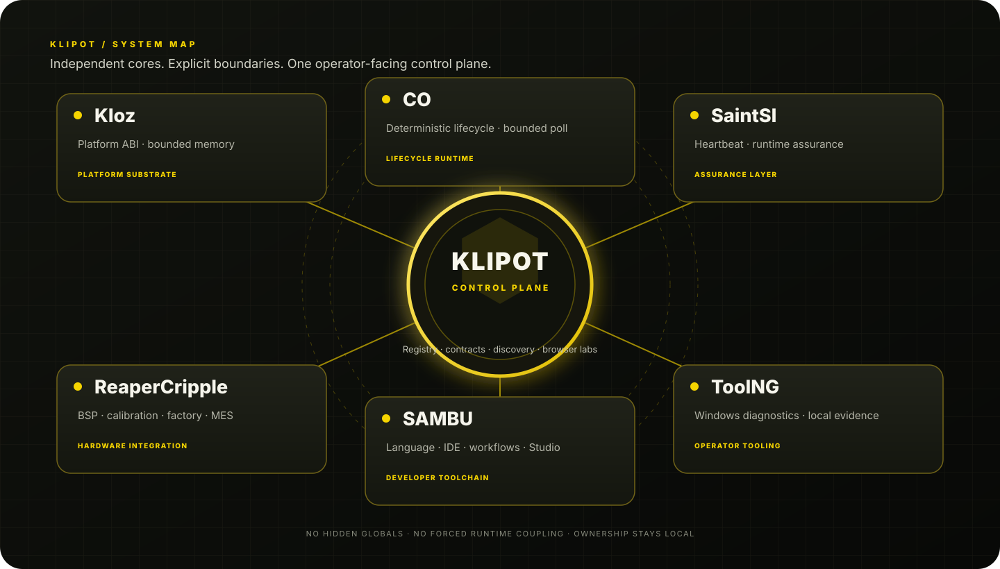
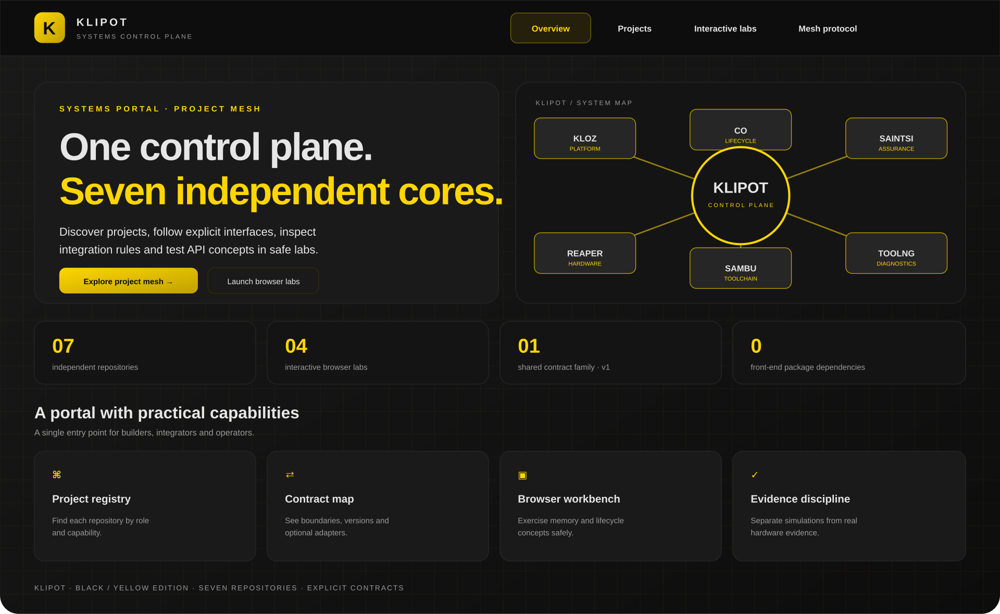

# Klipot — SAMBU Ecosystem Control Plane

**Klipot is the discovery, integration and operator-facing control plane for seven independent engineering repositories.** It connects their contracts, documentation, tools and evidence without collapsing their distinct runtime responsibilities.

<p align="center">
  
</p>

<p align="center">
  <a href="https://github.com/bboroski/Klipot/actions/workflows/pages.yml"></a>
  
  
</p>

## Open the portal

The single-file web application is available at [Klipot GitHub Pages](https://bboroski.github.io/Klipot/) after GitHub Pages is enabled for the repository and the deployment workflow has completed. The source is [index.html](index.html).

The portal includes:
- a repository directory with domain filters and search;
- direct repository and GUI-documentation links;
- copyable clone URLs;
- interactive browser labs for Kloz arena allocation, CO lifecycle transitions, SaintSI heartbeat monitoring and ReaperCripple capability gates;
- the machine-readable ecosystem registry and integration protocol.

The labs simulate API concepts in the browser. They do not execute C code, collect real hardware telemetry, run factory fixtures or prove a device state.

## The seven-project mesh

| Repository | Responsibility | Existing surface |
|---|---|---|
| [Kloz](https://github.com/bboroski/Kloz) | Platform ABI, bounded memory and board/CPU boundary | C11 library |
| [CO](https://github.com/bboroski/CO) | Deterministic component lifecycle and bounded polling | C11 library |
| [SaintSI](https://github.com/bboroski/SaintSI) | Heartbeat supervision and non-cryptographic integrity checks | C11 library |
| [ReaperCripple](https://github.com/bboroski/ReaperCripple) | BSP integrations, calibration, production fixtures and MES event flow | C11/CMake framework |
| [SAMBU](https://github.com/bboroski/SAMBU) | Language, developer tools, workflows and policy descriptions | Python CLI, Tkinter IDE and Duck Studio |
| [ToolNG](https://github.com/bboroski/ToolNG) | Local Windows-side Apple connection diagnostics and evidence reports | Native Win32/C17 app |
| **Klipot** | Registry, shared contracts, project discovery and browser workbench | HTML/CSS/JavaScript portal |

## Shared contracts

- [Integration protocol](docs/INTEGRATION_PROTOCOL.md) — responsibility boundaries, adapter status, versioning and evidence semantics.
- [Mesh envelope reference](contracts/mesh-envelope.h) — a fixed-width, versioned C record layout for optional cross-project observations. It is not a transport or a serialization format.
- [Machine-readable registry](registry/ecosystem.json) — project roles, provided/consumed capabilities and maturity labels.

The embedded libraries remain independently buildable. Optional adapters are explicit and must preserve their host projects' allocation, timing, concurrency and safety guarantees. The portal is not linked into firmware.

## Design principles

1. **Domain ownership:** a project owns its code, APIs and release decisions.
2. **Explicit coupling:** integration happens through versioned interfaces, never undocumented shared globals.
3. **Evidence before status:** distinguish observed, not found, unknown, failed and passed.
4. **Bounded execution:** fixed capacity, explicit ownership and reviewable timeouts remain first-class.
5. **Safety boundaries:** UI recommendations do not silently perform device or board actions.
6. **Honest maturity:** an adapter-ready contract is not described as a completed production integration.

## Run locally

Open index.html in a modern browser. No framework, build step, account, server or external JavaScript package is required. For a local web server:

```sh
python -m http.server 8080
```

Then open http://localhost:8080.

## Deploy

The GitHub Actions workflow in .github/workflows/pages.yml validates the portal assets and deploys the repository root to GitHub Pages. Enable **Settings → Pages → GitHub Actions** once in the repository settings. The public Pages URL becomes available after the first successful deployment.

## Validation boundaries

A host test validates portable software invariants only. A target compiler, linker map, startup path, board revision, calibrated fixture, measurement provenance and hardware-in-the-loop result are separate evidence gates. Klipot displays these boundaries; it does not waive them.


## SAMBU Ecosystem module

Klipot remains the static registry portal and operator-facing workbench. Its registry is a projection of SAMBU's canonical registry; browser labs remain simulations and are not firmware dependencies.

- **Module manifest:** [`sambu.module.json`](sambu.module.json)
- **Canonical architecture:** [SAMBU Ecosystem Architecture](https://github.com/bboroski/SAMBU/blob/main/docs/ECOSYSTEM_ARCHITECTURE.md)
- **Shared integration protocol:** [Klipot protocol](https://github.com/bboroski/Klipot/blob/main/docs/INTEGRATION_PROTOCOL.md)


## Integration verification

The [cross-repository contract workflow](.github/workflows/mesh-contracts.yml) checks the optional C header adapters against the current default branches of Kloz, CO, SaintSI and ReaperCripple. It also validates the seven manifests, localized README diagrams and portal JavaScript syntax. It is a compile/metadata check, not a hardware qualification test.

[ Kloz manifest ](ecosystem/manifest.json) · [ Mesh protocol ](docs/INTEGRATION_PROTOCOL.md) · [ Registry ](registry/ecosystem.json)


## Portal interface preview

<p align="center"></p>

The UI includes animated view transitions, responsive project cards, search/filter controls, pressed/hover states and interactive API-concept labs. [Interaction and design guide](docs/PORTAL_UI.md). This SVG is a static illustration of the layout, not a live application screenshot.
