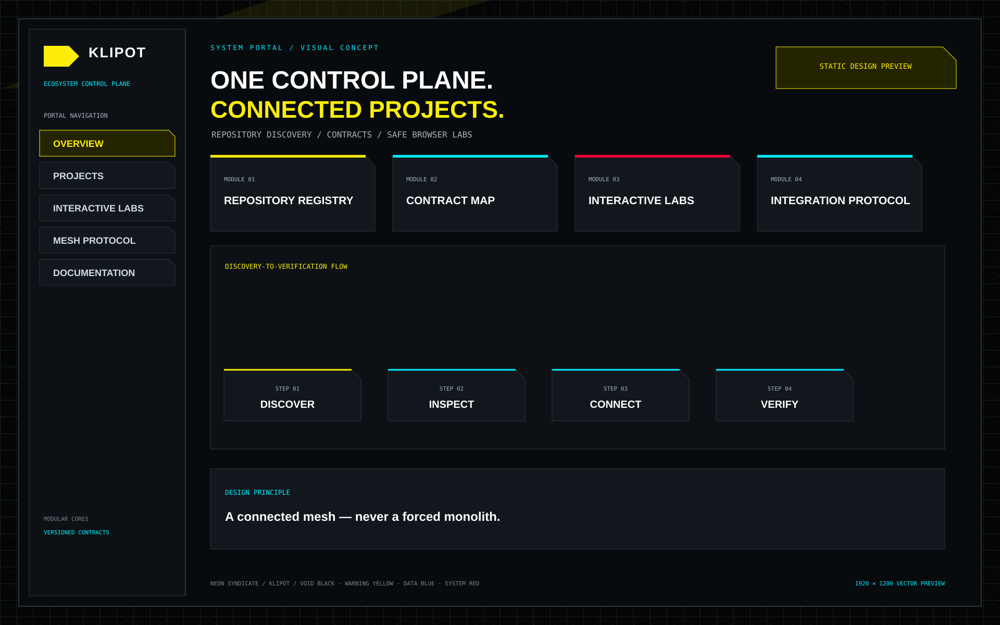
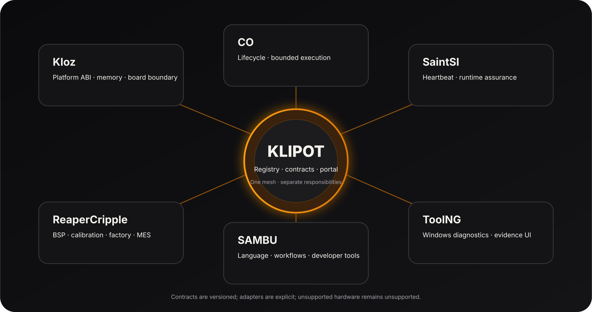

<p align="center"></p>
<h1 align="center">Klipot</h1>
<p align="center"><strong>Ecosystem Integration & Control Plane</strong></p>
<p align="center"></p>
<p align="center"><a href="README.md">🇺🇦 Українська</a> · <a href="README.en.md">🇬🇧 English</a> · <a href="README.ru.md">🇷🇺 Русский</a></p>
<sub>Оновлено: 2026-11-11</sub>


## NEON SYNDICATE — portal visual overview

<p align="center"></p>
<p align="center"><em>Static vector design preview, not a browser screenshot. The live portal is implemented in index.html.</em></p>

[Brand and interface specification](design/NEON_SYNDICATE.md) · [Design tokens](design/neon-syndicate.tokens.json)

## Навігація

- [Поточні можливості](#поточні-можливості)
- [Швидкий старт і перевірка](#швидкий-старт-і-перевірка)
- [Архітектура, межі та достовірність](#архітектура-межі-та-достовірність)
- [Прев'ю порталу](#превю-порталу)
- [Інженерна якість](#інженерна-якість)
- [Карта документації](#карта-документації)
- [NUN Mesh та пов'язані репозиторії](#nun-mesh-та-повязані-репозиторії)
- [Дизайн і документація](#дизайн-і-документація)
- [Ліцензія](#ліцензія)

> **Klipot** — Klipot — центральний каталог і контрольна площина інженерної екосистеми: модулі, ролі, контракти, посилання та перевірювані інтеграційні межі.

## Поточні можливості
- Каталог репозиторіїв із пошуком і фільтрами.
- Machine-readable registry та versioned integration protocol.
- Browser-labs для локальної демонстрації allocation, lifecycle і capability-gate моделей.
- CI-перевірки метаданих, схем, контрактів і JavaScript.
- Оновлений cross-repository roadmap та quality contracts.

## Швидкий старт і перевірка
```bash
python -m http.server 8080
# open http://localhost:8080
python one.py check
```

## Архітектура, межі та достовірність
Browser-labs використовують локальну модель і synthetic data; вони не запускають native C, не читають hardware telemetry і не керують пристроями. Каталог не перетворює незалежні репозиторії на моноліт.

## Прев'ю порталу

Статичне векторне прев'ю концепції Klipot у стилі NEON SYNDICATE. Це дизайн-макет, а не скриншот запущеного порталу.

<p align="center"></p>
<p align="center"><em>Портал, каталог репозиторіїв і швидкі переходи до лабораторій</em></p>

## Інженерна якість
- Перевіряйте збірку й тести саме для цільової платформи; host CI не замінює hardware qualification.
- Статуси **implemented**, **partial**, **planned** мають підтверджуватися кодом, тестами та документацією.
- Не оголошуйте функцію production-ready лише на підставі макета, специфікації чи відкритого Pull Request.
- Зовнішні інтеграції мають бути явними, версіонованими, ізольованими й перевірюваними.

## Карта документації

- [Архітектура порталу](docs/ARCHITECTURE.md)
- [Контракти екосистеми](docs/CONTRACTS.md)
- [Інтеграційний протокол](docs/INTEGRATION_PROTOCOL.md)
- [Інтерфейс порталу](docs/PORTAL_UI.md)

## NUN Mesh та пов'язані репозиторії
<p align="center"></p>

[SAMBU](https://github.com/bboroski/SAMBU) · [ToolNG](https://github.com/bboroski/ToolNG) · [ReaperCripple](https://github.com/bboroski/ReaperCripple) · [Kloz](https://github.com/bboroski/Kloz) · [CO](https://github.com/bboroski/CO) · [SaintSI](https://github.com/bboroski/SaintSI) · [Klipot](https://github.com/bboroski/Klipot) · [NUN](https://github.com/bboroski/NUN) · [NUNLauncher](https://github.com/bboroski/NUNLauncher)

Репозиторії зберігають власні назви, код, API, цикли випуску та межі відповідальності. Інтеграція означає узгоджені контракти, а не автоматичне злиття незалежних runtime.

## Дизайн і документація
Базовий інтерфейсний напрям екосистеми — **NEON SYNDICATE**: чорні поверхні, жовтий акцент для дій і станів, читабельна типографіка, доступний контраст, клавіатурна навігація та підтримка reduced motion. Деталі дивіться в [design/NEON_SYNDICATE.md](design/NEON_SYNDICATE.md), якщо файл присутній у цьому репозиторії.

## Ліцензія
Ліцензію не оголошено; файл LICENSE відсутній.

---
**Створено з любов'ю до інженерії, системності та людей.**

## Федерація Hellduck

Цей репозиторій входить до федерації [Hellduck](https://github.com/bboroski/Hellduck) — спільного каталогу проєктів, контрактних зв’язків і станів інтеграції. Вихідний код, API, тести та цикл випуску залишаються відповідальністю цього репозиторію; Hellduck індексує зв’язки й не завантажує та не виконує код учасників.
