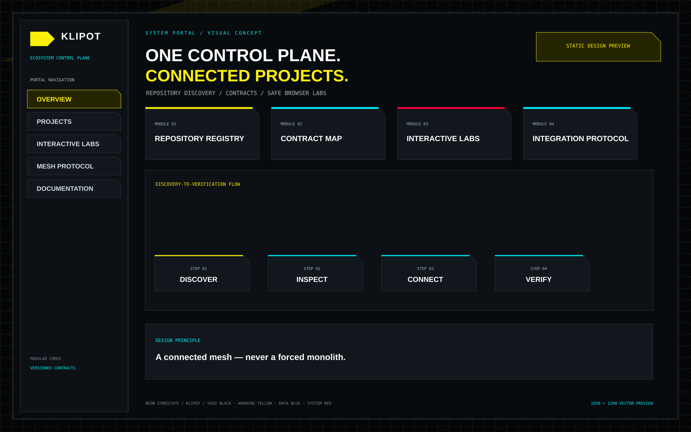

# Klipot
**Ecosystem Integration & Control Plane**

[Українська](README.md) · [English](README.en.md) · [Русский](README.ru.md)

Статический портал на HTML/JavaScript для инженерной экосистемы: каталог репозиториев, контракты, ссылки и границы интеграции.

## Возможности
- Каталог репозиториев с поиском и фильтрами.
- Машиночитаемый registry и версионированный протокол интеграции.
- Browser labs для локальной демонстрации allocation, lifecycle и capability gates.
- CI-проверки метаданных, схем, контрактов и JavaScript.

## Запуск и проверка
```bash
python -m http.server 8080
# открыть http://localhost:8080
python one.py check
```

## Границы
Browser labs используют локальные модели и синтетические данные. Они не запускают native C, не читают аппаратную телеметрию и не управляют устройствами. Портал не объединяет независимые runtime.

## Документация проекта


*Статическое векторное превью, не live-скриншот браузера.*

## Связанные проекты
[Исходный портал](index.html) · [дизайн-гайд](design/NEON_SYNDICATE.md)

[Hellduck](https://github.com/bboroski/Hellduck) · [Luci](https://github.com/bboroski/Luci)

## Лицензия
Корневой LICENSE не объявлен; перед повторным использованием проверьте условия репозитория.

---
**愿我如星君如月，夜夜流光相皎洁。**
*Пусть я буду звездой, а ты луной, и каждую ночь мы будем сиять друг для друга.*
— Фань Чэнда, 《车遥遥篇》
